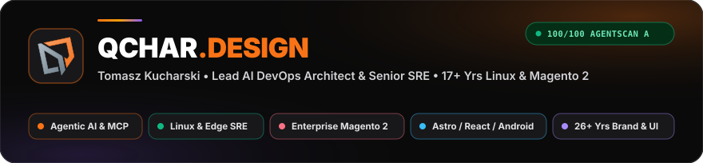
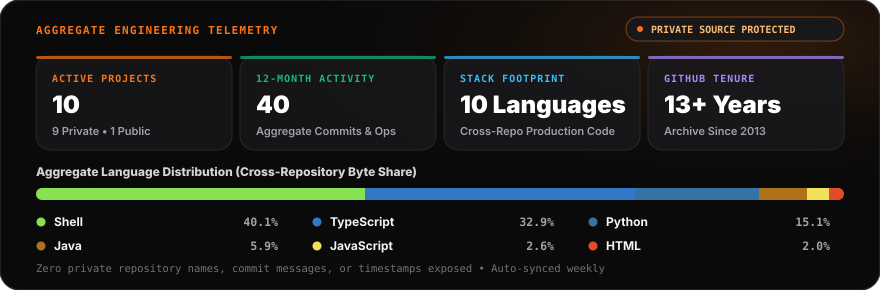

  

  
  
  
  
  
  

  

---

### Production QD Ecosystem & Public Web Architecture

| Property | Focus & Capabilities | Core Stack | Live Endpoint |
| :--- | :--- | :--- | :--- |
| **Qchar Design** | SRE Architecture Case Studies, 71-Work Design Archive & Print-Ready Interactive CV | Astro 5, React 19, Tailwind v4, WebMCP | [qchardesign.com](https://qchardesign.com) |
| **Ecosystem Hub** | Executive Brand Portal, `⌘K` Launcher & SHA-256 Delta Sync Manifest | Astro 5, `@qd/web-ui`, MCP 1.0, OpenAPI 3.1 | [hub.qchardesign.com](https://hub.qchardesign.com) |
| **QD FPL** | Live Matchday Fantasy Premier League xP/BPS Telemetry (`#44` World Hall of Fame) | TypeScript, React, Capacitor Android, IndexedDB | [fpl.qchardesign.com](https://fpl.qchardesign.com) |
| **QD BPM** | Clinical ESC/NICE Cardiovascular Telemetry, Audio Briefs & Zero-Split A4 PDF Export | React, SQLite WAL, Android PrintManager, Edge-TTS | [bpm.qchardesign.com](https://bpm.qchardesign.com) |
| **QD Manager** | Multi-Repo Portfolio Aggregator, AI Quota Rings & Wear OS Pixel Watch Tile | TypeScript, Kotlin / Wear OS ProtoLayout, SwiftBar | [pm.qchardesign.com](https://pm.qchardesign.com) |
| **QD SM** | Autonomous Editorial Intelligence Studio, Video Reels & HITL Draft Holds | TypeScript, Playwright, HyperFrames, FFmpeg | [sm.qchardesign.com](https://sm.qchardesign.com) |

---

### Core Engineering & Architecture Disciplines

- **Enterprise SRE & Linux Infrastructure (17+ Years):** High-availability Ubuntu/Nginx architecture, zero-downtime blue/green pipelines, edge PCRE threat filtration, MySQL/MariaDB tuning, and enterprise Magento 2 (Adobe Commerce) scaling.
- **Autonomous Agentic AI & Protocols:** Multi-pool AI orchestration (`MCP 1.0`, declarative Google `WebMCP`, `/llms.txt`, `OpenAPI 3.1`), deterministic Playwright cross-viewport verification, and automated CI/CD release gates (`100/100 AgentScan Grade A`).
- **Modern Web, Mobile & Wearables:** Astro 5, React 19 Islands, TypeScript, Tailwind CSS v4, Capacitor Android 12+ native builds, and Wear OS ProtoLayout tiles.
- **Creative Direction & Design Systems (26+ Years):** True Black `#0A0A0A` + Brand Orange `#f97316` unified token architecture, bespoke vector identity systems, and pre-press print engineering.

---

  All application and infrastructure source repositories remain private by design. Full architecture case studies, 71-work design portfolio, and print-ready A4 CV are published at <a href="https://qchardesign.com">qchardesign.com</a>.

